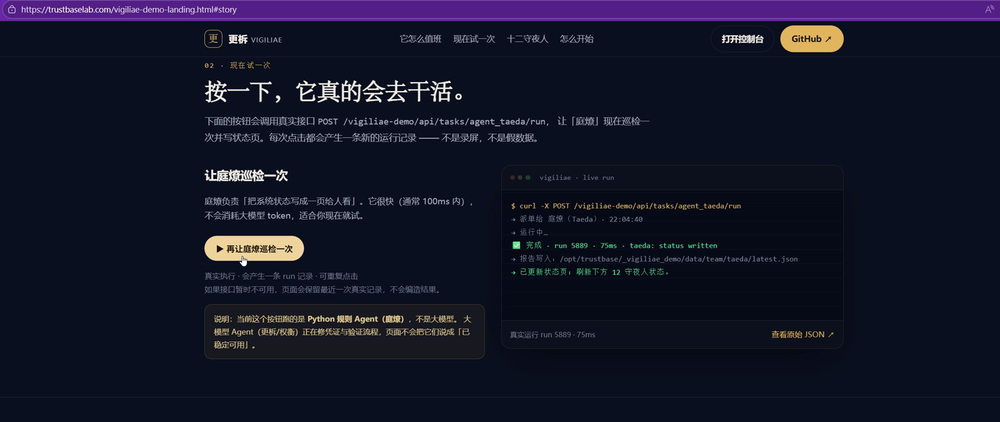

# Vigiliae · 更柝

**A self-hosted AI agent team that runs 24/7 on your own VPS, hands off with your local agent, and schedules heavy work to off-peak API pricing.**

**Twelve named agents. Your data never leaves your machine. Turn off your laptop — they keep working.**

[](https://github.com/Trustbaselab/vigiliae/actions/workflows/tests.yml)
[](LICENSE)
[](https://www.python.org/)
[](#honest-limitations)

[中文说明 / Chinese README](README.zh.md)

---

## Demo



*Click play, and it really runs — a real POST /api/tasks/agent_taeda/run,
a real run id, a real 75 ms. Not a screen recording of a mock.*

[▶ Watch the 25-second demo](docs/vigiliae-demo-25s.mp4) · [12 named agents](docs/screenshot-agents.png)

---

## In 30 seconds

```
You pay:  one VPS (~$30-70/month)
You get:
  · 12 named AI agents on duty, 24/7
  · Turn off your laptop — the server keeps working
  · 100% of your data stays on your own machine
  · Composable, extensible skills
  · Bring your own model (DeepSeek / Qwen / local)

⭐ Grok is banned in China, Indonesia and Malaysia; Meta Muse is US-only
   (and still not in Korea). And even where they work, enterprises cannot
   use them — the data leaves the country. Vigiliae runs on your own server.
```

---

## Quick start

```bash
# 1. Install
pip install vigiliae

# 2. Initialize (generates the 12-agent config)
vigiliae init

# 3. Run (default port 8110)
vigiliae serve

# 4. Open
open http://localhost:8110
```

**Or with Docker:**

```bash
git clone https://github.com/Trustbaselab/vigiliae
cd vigiliae
cp .env.example .env        # at minimum, set BOT_TOKEN
docker compose up -d
```

**Attach a thinking kernel (optional, recommended):**

```bash
# Vigiliae uses DSH (DeepSeek Harness) as its "brain".
# Without this, the 4 LLM-backed agents stay idle.
export DEEPSEEK_API_KEY=sk-xxxxxxxx
```

**⭐ That's it. The 12 agents start on their own. HTTP/Python agents run immediately; LLM agents wait for the key.**

---

## What it actually does

**One line: you have 12 AI employees with distinct roles, each owning one slice of the work.**

| Watch | Role | What you use it for |
|---|---|---|
| **Vigiliae** | Orchestrator | Decides who is on duty and what runs next |
| **Hesperus** | Dual-state presence | Cloud takes over when your laptop goes offline |
| **Sol et Luna** | Shift & price clock | Heavy work runs only in off-peak windows |
| **Nox media** | Cost window guard | Keeps API spend under control |
| **Annales** | Chronicler | Every run archived and traceable |
| **Libra** | Verifier | Checks sources and confidence; anti-hallucination |
| **Nuntius** | Messenger | Pushes results out (messages, briefs) |
| **Porta** | Gatekeeper | Approval gates; unapproved writes are blocked |
| **Taeda** | Lamp | Turns system state into readable reports |
| **Arachne** | Weaver | Links entities and sources into a reviewable graph |
| **Sator** | Seeder | Collects data against identified gaps |
| **Terminus** | Anchor | Hashes and anchors artifacts; never deletes |

**⭐ Every name has a real classical source — Roman *vigiliae* and the Chinese *geng* watch system. See [NAMING.md](NAMING.md).**

---

## Five built-in skills (no plugins required)

```bash
python -m vigiliae.memory  --help    # Memory: remember things across sessions
python -m vigiliae.verify  --help    # Verify: check a data record's source
python -m vigiliae.patrol  --help    # Patrol: check system health
python -m vigiliae.collect --help    # Collect: find data against gaps
python -m vigiliae.report  --help    # Report: one output format
```

**Each skill runs standalone and can be called by any agent.**

**⭐ Every skill has a `--check <input.json>` that returns structured evidence, not just pass/fail. See [docs/AGENTS.md](docs/AGENTS.md).**

---

## Why this, not something else

### 1. Local ↔ cloud handoff

When your laptop is online it does the work; when it goes offline, the cloud takes over. **Heartbeat detection + takeover protocol** — no lost tasks, no re-running what already finished.

```
[your laptop]  ──heartbeat──▶  [your VPS]
     │                            │
  off / offline                   │
     ✗                            ▼
                             takes over, keeps working
```

### 2. Pricing-aware scheduling

Heavy jobs move into off-peak API windows automatically. **Same work, half the cost.**

### 3. Agent boundaries live in YAML

What each agent can write, whether it needs approval, whether it is read-only or can execute — declared in `agents.yaml` and **enforced at runtime**, not requested from a model in a prompt.

### 4. Rule engine + LLM, two tiers

Deterministic work goes to the rule engine; only reasoning goes to the LLM. **Cheaper, reproducible, auditable.**

### 5. Bring your own thinking kernel

Not tied to any model. DSH, or any CLI that can output text. You can run it with no LLM at all and only use the rule engine.

**⭐ [How to plug in any model: docs/models.md](docs/models.md)** — Ollama (local), Claude, GPT-4o, DeepSeek, Kimi, GLM, Qwen, llama.cpp. One wrapper script each.

---

## Comparison

| | Grok Bot | Meta Muse | SaaS assistants | **Vigiliae** |
|---|:-:|:-:|:-:|:-:|
| Available outside the US | ❌ | ❌ | ✅ | **✅** |
| Data stays with you | ❌ | ❌ | ❌ | **✅** |
| Always on | ✅ | ✅ | ✅ | ✅ |
| Keeps working when you shut down | n/a | n/a | ✅ | **✅** |
| Multi-agent team | partial | ✅ | partial | **✅ 12 agents** |
| Self-hostable | ❌ | ❌ | few | **✅** |
| Custom skills | ❌ | partial | ❌ | **✅** |
| Cost | high ($) | high ($) | medium | **low (VPS only)** |

---

## Architecture

```
┌─────────────────────────────────────────────┐
│              Vigiliae                        │
├─────────────────────────────────────────────┤
│  Orchestration: 12 agents (each YAML-config) │
│    · write_perm / need_approve / exec_pref   │
│    · reports_to / depends_on                 │
├─────────────────────────────────────────────┤
│  Skills: memory / verify / patrol /          │
│          collect / report                    │
├─────────────────────────────────────────────┤
│  Core: rule engine + price scheduler +       │
│        handoff protocol                      │
├─────────────────────────────────────────────┤
│  Storage: SQLite (tasks/runs/approvals/      │
│           heartbeats)                        │
├─────────────────────────────────────────────┤
│  Brain: DSH headless (swappable CLI)         │
└─────────────────────────────────────────────┘
```

**Runtime mechanics, data flow, and state machines: [ARCHITECTURE.md](docs/ARCHITECTURE.md).**

---

## Write your first agent

```yaml
# agents.yaml
agents:
  - id: agent_myscraper
    name: My Scraper
    desc: Scrape industry news once a day at 08:00
    kind: python              # python | http | agent
    schedule: "cron:0 8 * * *"
    exec_pref: cloud          # local | cloud | either
    write_perm: 0             # read-only
    need_approve: 0           # no approval needed
    payload:
      script: scripts/scrape.py
```

```bash
vigiliae agents sync agents.yaml      # sync into the database
vigiliae agents run agent_myscraper   # run once now
```

**Full reference: [agents.yaml](agents.yaml) (12-agent example config).**

---

## API

```bash
# List tasks
curl http://localhost:8110/api/tasks

# Runtime status
curl http://localhost:8110/api/status

# Trigger manually
curl -X POST http://localhost:8110/api/tasks/agent_vigiliae/run

# Approvals
curl http://localhost:8110/api/approvals
curl -X POST http://localhost:8110/api/approvals/1/decide -d '{"decision":"approve"}'

# Handoff state
curl http://localhost:8110/api/handover
```

**Authentication:** the first request must carry `?k=<BOT_TOKEN>`; the app sets an
HttpOnly cookie and later requests need no token. API calls with a valid `?k=`
return 200 directly (no redirect); browser UI redirects to set the cookie.

**Full OpenAPI: [docs/api.md](docs/api.md).**

---

## Configuration

```bash
# .env
VIGILIAE_PORT=8110
VIGILIAE_DATA_DIR=./data
BOT_TOKEN=your_token              # optional, for message push
DSH_BIN=dsh                       # path to the thinking kernel
DSH_PROFILE=headless              # which profile to boot
DEEPSEEK_API_KEY=sk-xxxx          # required for LLM agents
```

**All options: [docs/configuration.md](docs/configuration.md).**

---

## Operating modes

| Mode | Description | When to use |
|---|---|---|
| `local` | Runs only on your machine | Development / testing |
| `cloud` | Runs only on the VPS | Production |
| `either` | Whoever is online runs it | Default (with handoff) |
| `local_first` | Local first, cloud takes over when offline | Laptop + VPS |

---

## Honest limitations

**We would rather tell you what does not work than oversell:**

```
✗ One-command install — it is 3 steps (pip install / init / serve), not yet curl | bash
✗ Multi-tenancy — single host, single user, no tenant isolation
✗ Enterprise audit — basic run logs only, not compliance-grade
✗ Cloud computer — agents cannot drive a GUI or click web pages (Grok Bot can; we cannot)
✗ Industry skill packs — 5 general skills, no vertical packs yet
✗ Local model — currently calls DeepSeek via API, Ollama not wired yet
✗ External users — apart from ourselves, nobody uses it in production yet
```

**⭐ Tracked in [Roadmap](#roadmap), ordered by priority.**

---

## Roadmap

```
2026 Q4
  ✅ 12-agent orchestration
  ✅ Local↔cloud handoff
  ✅ Pricing-aware scheduling
  ✅ 5 built-in skills
  ✅ Plugin-free verifiable skills (v2: --check + feedback)
  ⏳ One-command install (curl | bash)
  ⏳ Public demo you can understand in 5 minutes
  ⏳ Clean English/Chinese split docs

2027 Q1
  ⏳ Industry skill packs (carbon data / e-commerce / legal)
  ⏳ Browser automation (Playwright)
  ⏳ Multi-tenancy
  ⏳ Enterprise audit

2027 Q2+
  ⏳ Local models (Ollama)
  ⏳ Agent marketplace
```

---

## The name

The name is not arbitrary. **Vigiliae** is the Roman night divided into four watches; **更柝** (*gēng tuò*) is the Chinese night divided into five. Two civilisations, separated by continents and with no contact, arrived at the same institution: **cut the night into shifts and hand each shift to the next, so someone is always awake.**

**Full sources — *Digesta*, the *I Ching*, the *Ballad of Mulan*, the *Rites of Zhou*, the *Tang Code* — in [NAMING.md](NAMING.md).**

---

## Contributing

See [CONTRIBUTING.md](CONTRIBUTING.md). We especially welcome:

```
· Industry skill packs (you know what your vertical is missing)
· Deployment reports (what broke where)
· Bugs, especially across platforms and containers
```

**Security: [SECURITY.md](SECURITY.md).**

---

## License

MIT — see [LICENSE](LICENSE).

**⭐ The open-source edition is free, complete, and commercially usable. An enterprise edition (multi-tenancy / audit / SSO) is licensed separately.**

---

## Acknowledgements

```
· DeepSeek Harness (DSH) — the thinking kernel
· The 12 names — Homer, Hesiod, Virgil, Livy, the Digesta,
  the I Ching, the Book of Songs, the Chu Ci, the Book of Rites,
  the Zuo Zhuan, the Tang Code, the Classic of Mountains and Seas
· Skill mechanisms studied from MIT-licensed DSH community plugins:
  dsh-memory-manager / dsh-mcp-manager / dsh-skill-manager
  We studied the mechanisms and reimplemented them in Python inside
  vigiliae — no plugin dependency.
```

---

**Built by [Trustbase Lab](https://trustbaselab.com)**

*Four watches. Never a gap.*
