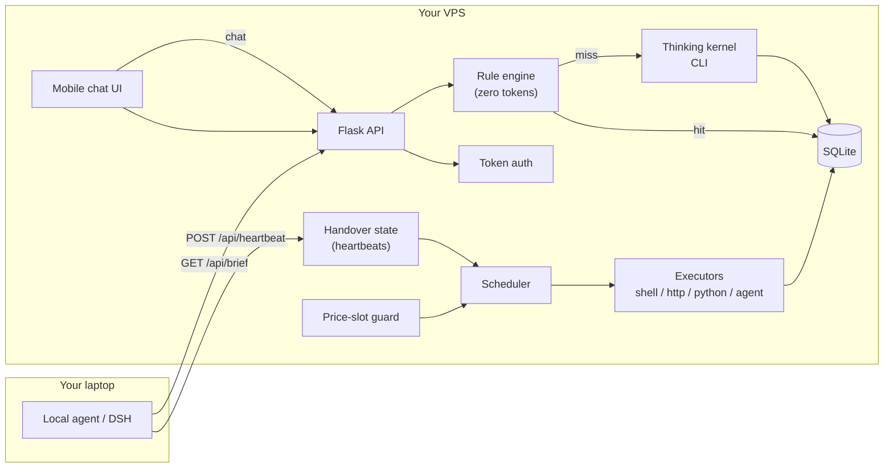

# Vigiliae · 更柝

**A self-hosted AI agent team that runs 24/7 on your own VPS, hands off with your local agent, and schedules heavy work to off-peak API pricing.**

[](LICENSE)
[](#honest-status)

## The name

### Vigiliae · the Roman night watch

In the Roman Empire, the night was not a single stretch of darkness. It was
**divided into four watches** — *vigiliae* — each roughly three hours long.
Every watch was held by a different cohort of the **vigiles**, the night
watchmen of Rome. At the end of each shift the outgoing watch formally handed
the city over to the incoming one. No hour of the night was ever unwatched.

The institution was not informal. Augustus established the *vigiles* as a
standing corps of seven cohorts around 6 BC, tasked with firefighting and
night policing across the fourteen regions of Rome. Their duties, their
subordination, and their liability were codified in law: **book 1, title 15 of
the *Digesta***, *De officio praefecti vigilum* — "On the office of the prefect
of the watch." A Roman jurist could tell you, 2,000 years ago, exactly who was
responsible for the city between the third and fourth watch.

The word survives in modern languages: *vigil*, *vigilance*, *vigilante*, the
Spanish *vigilia*, the Italian *veglia*. All of them mean the same thing —
**someone is staying awake so that you can sleep.**

### 更柝 · the Chinese watch of the fifth night

Classical China solved the same problem with the same architecture, without
ever seeing Rome.

The night was divided into **five watches** — *更* — beginning at dusk and
ending at dawn. At each watch a watchman walked the streets striking a wooden
clapper called a **柝**. The sound was the signal: *the watch is being kept, the
hour has turned, all is well.* The practice gave Chinese its most common idiom
for the middle of the night — **三更半夜**, "the third watch, the middle of the
night."

The image is old enough to appear in the **I Ching** (系辞下), in a passage
about how a ruler secures a city:

> **重门击柝，以待暴客**
> *Double gates and the clapper, to await the night intruder.*

It returns in the **Ballad of Mulan**, in the famous couplet describing a
soldier's night on campaign:

> **朔气传金柝，寒光照铁衣**
> *The northern air carries the brazen clapper; the cold light falls on
> iron armour.*

And the administrative machinery appears in the **Rites of Zhou** (周礼·夏官),
where an officer called the *Qi Hu Shi* kept the water-clock and ordered the
clapper to be struck, and later in the **Tang Code** (唐六典), which recorded
the terms **上直** ("taking up the watch") and **下直** ("coming off the
watch") for officials on night duty. The handoff was a matter of law, not
courtesy.

### Two civilisations, one invention

Neither tradition borrowed from the other. Rome and China were separated by
thousands of miles and had no contact. Yet both arrived at the identical
solution:

> **Divide the night into shifts, and hand each shift to the next,
> so that someone is always awake.**

That is the entire mechanism of this project. A local agent and a cloud agent
hold the watch in turn. When the laptop closes, the cloud takes over. When it
opens again, the cloud hands back. Between them, the work never stops.

We did not name it after a robot. We named it after the watch.

### Why this matters for what we build

The *vigiles* were not merely people who stayed up. They were a **system** —
with divisions, schedules, handoff procedures, jurisdictions, equipment
standards, and legal accountability. The value was never that one person was
awake. The value was that the *institution* guaranteed continuity regardless of
which individual was on duty.

That is exactly the design problem we are solving. The hard part of an AI agent
is not making it run once. The hard part is making it run **tomorrow at 3 a.m.,
after you have gone home, with the same boundaries, the same audit trail, and
the same standards** — and then handing control back to you cleanly when you
return.

Vigiliae is that institution, written as software. The name is a reminder of
what we are actually building: not a chatbot, not a model — a **watch that does
not break.**

---

> **Honest status**: early stage, used in production by Trustbase Lab on a single
> 4-core / 7.5 GB VPS since October 2026. One maintainer. Not a hardened
> multi-tenant platform. No formal test suite yet. If you need a polished agent
> OS, look at the projects in the [comparison](docs/COMPARISON.md) first.

```
 local agent (laptop)  ──heartbeat──▶  Vigiliae (VPS)  ──▶  scheduled agents
        ▲                                   │
        └────────── chat / task bus ◀───────┘
```

---

## Why this exists

Cloud agents are useful exactly when your laptop is closed. But most of them
are vendor-hosted and priced per seat, and they cannot share state with the
agent running on your own machine.

Vigiliae is the small piece we wanted and could not find:

- a **persistent task runner** that keeps working after you shut the lid;
- a **handoff protocol** so the laptop and the VPS know who is in charge;
- a **price-aware scheduler** so non-urgent heavy jobs run when the API is
  cheaper;
- **boundaries in a config file**, enforced by the runtime, not by a prompt;
- a **mobile chat UI** that works in a normal browser, including WeChat's
  in-app browser.

It is deliberately not an agent framework. It does not plan, reason, or browse
by itself. It schedules work, enforces boundaries, and delegates thinking to a
CLI you already trust.

---

## What makes it different

### 1. Local ↔ cloud handoff

The local agent POSTs `/api/heartbeat` every 30 seconds. If the heartbeat is
older than `VIGILIAE_HEARTBEAT_TIMEOUT` (default 120 s), Vigiliae marks the
local machine offline and takes over tasks whose `exec_pref` is `cloud` or
`either`. When the laptop comes back, it resumes `local`/`either` work.

```
local online   → role=local_primary   → cloud stands by
local offline  → role=cloud_takeover  → cloud executes
```

This is one table and one timestamp. No consensus, no message broker.

### 2. Off-peak price scheduling

Some LLM providers charge list price during weekday business hours and roughly
**half price** outside them. Tasks marked `heavy: true` are deferred when they
fire inside a peak window, and retried at the next off-peak boundary.

```
peak:     weekdays 09:00–12:00, 14:00–18:00 (local time)
off-peak: lunch, evenings, nights, weekends, holidays
```

Deferrals are persisted to `data/deferred.json` and exposed at `/api/deferred`,
so you can audit every "why didn't it run at 10:00?" question.

### 3. Agent boundaries live in YAML

Each agent has `allow` and `deny` lists. The runtime applies three independent
gates on top of the prompt:

| Gate | What it does |
|---|---|
| `write_perm=0` | shell tasks are read-only; dangerous patterns are rejected |
| `need_approve=1` | the run is parked in `approvals` until a human approves |
| `deny` list | injected into the prompt as a hard constraint |

The prompt is not the security boundary. The task row is.

### 4. Rule engine + LLM, two tiers

`status`, `tasks`, `runs`, `price`, `agents`, `inspect`, `help` are answered by
a keyword rule engine with **zero tokens**. Only messages that miss every rule
go to the thinking kernel. In practice this handles most chat traffic for free.

### 5. Bring your own thinking kernel

Vigiliae does not embed a model runtime. It shells out to a CLI:

```bash
dsh --profile headless "<prompt>"
```

[DSH](https://github.com/deepseek-ai) is the reference implementation, but
any "prompt in, answer out" CLI works — a local Ollama wrapper, an
OpenAI-compatible script, etc. Replace `vigiliae/bridge.py` if your CLI has a
different shape.

---

## Comparison

Star counts were read from the GitHub API on **2026-10-27**. "Not documented"
means we read the public repo description/README on that date and did not find
the feature; it does not mean it is impossible. See
[`docs/COMPARISON.md`](docs/COMPARISON.md) for the full matrix and sources.

| Project | Stars | License | Self-hosted | Local↔cloud handoff | Off-peak scheduling | Config-enforced boundaries | Thinking kernel |
|---|---:|:---:|:---:|:---:|:---:|:---:|---|
| **Vigiliae** (this repo) | — | MIT | ✅ | ✅ | ✅ | ✅ | any CLI (DSH by default) |
| Grok Bots (xAI) | closed | proprietary | ❌ (vendor cloud) | ❌ | ❌ | ❌ | built-in |
| [rome](https://github.com/rome-os/rome) | 875 | MIT | ✅ | not documented | not documented | not documented | built-in |
| [guilds](https://github.com/CigaleAI/guilds) | 65 | AGPL-3.0 | ✅ | not documented | not documented | not documented | built-in |
| [agenhood](https://github.com/appssemble/agenhood) | 8 | MIT | ✅ | not documented | not documented | not documented | Claude Code / Codex / opencode |

Grok Bots is reported at roughly **$120–300/month per seat** (public reporting,
October 2026; pricing may change). Vigiliae is designed for the "I already have
a VPS" case: the marginal cost is whatever your model calls cost, and heavy
calls are pushed to the cheaper window.

> We are not claiming feature parity with these projects. rome and guilds are
> more mature on the UI/agent side. Vigiliae's bet is narrower: **ownership +
> handoff + cost control for a small team.**

---

## Architecture



Components:

| Module | Responsibility |
|---|---|
| `vigiliae/app.py` | Flask app, auth, JSON API, chat routes |
| `vigiliae/scheduler.py` | cron / interval loop |
| `vigiliae/executor.py` | shell / http / python / agent executors, gates |
| `vigiliae/price_slot.py` | peak/off-peak clock, heavy-job deferral |
| `vigiliae/handover.py` | heartbeat table, online/offline decision |
| `vigiliae/engine.py` | zero-token rule engine |
| `vigiliae/bridge.py` | subprocess bridge to the thinking kernel |
| `vigiliae/agents.py` | load `agents.yaml`, register tasks |
| `vigiliae/auth.py` | URL-token → cookie auth |

More detail: [`docs/ARCHITECTURE.md`](docs/ARCHITECTURE.md).

---

## Quick start

Three commands (Docker):

```bash
cp .env.example .env && cp agents.yaml.template agents.yaml   # 1. configure
# edit .env: set BOT_TOKEN at minimum            (optional: DSH_BIN)
docker compose up -d                                          # 2. start
# open http://localhost:8110                                  # 3. use it
```

Then register the example team:

```bash
docker compose exec vigiliae python -m vigiliae.agents sync
```

Without Docker:

```bash
python -m venv .venv && . .venv/bin/activate
pip install -r requirements.txt
cp .env.example .env && cp agents.yaml.template agents.yaml
python -m vigiliae
```

Run the tests (there are only a few; contributions welcome):

```bash
python -m unittest discover -s tests -v
```

> **No thinking kernel?** It still works. Messages are queued in SQLite and the
> rule engine answers instantly. When your local agent comes online it calls
> `GET /api/brief` and sees everything it missed.

---

## Write your first agent

An agent is a prompt + a schedule + boundaries. Copy
[`examples/my-first-agent.yaml`](examples/my-first-agent.yaml):

```yaml
team:
  name: "One-agent team"
  orchestrator: "greeter"

agents:
  - name: "greeter"
    role: "Morning greeting"
    description: "Reads the task history and writes a one-paragraph morning note."
    schedule: "cron:0 8 * * *"     # every day at 08:00 local time
    timeout: 600
    heavy: false
    boundaries:
      allow: ["read task history", "write a message to the chat"]
      deny: ["modify tasks", "send external email"]
    prompt: |
      You are the morning greeter. Read the latest task runs and write one
      short paragraph: what happened, what failed, what to check first.
```

Register it:

```bash
python -m vigiliae.agents sync examples/my-first-agent.yaml
```

It becomes a task with id `agent_greeter`. Trigger it once:

```bash
curl -X POST http://localhost:8110/api/tasks/agent_greeter/run
```

Full schema and scheduling syntax: [`docs/AGENTS.md`](docs/AGENTS.md).

---

## API

All endpoints are JSON. If `BOT_TOKEN` is set, send it as the `cb_auth`
cookie (log in once at `/login?k=<token>`) — or append `?k=<token>` once.

| Method | Path | Purpose |
|---|---|---|
| GET | `/api/health` | liveness (public) |
| GET | `/api/status` | role, counts, price window, kernel availability |
| GET/POST | `/api/tasks` | list / create tasks |
| POST | `/api/tasks/<id>/run` | run once (may return `deferred`) |
| POST | `/api/tasks/<id>/toggle` | enable / disable |
| GET | `/api/runs` | recent executions |
| POST | `/api/heartbeat` | local agent heartbeat (public) |
| GET | `/api/handover` | who is in charge |
| GET | `/api/approvals` | pending approvals |
| POST | `/api/approvals/<id>` | `{"approve": true}` |
| GET/POST | `/api/messages` | chat queue |
| POST | `/api/messages/read` | mark messages read |
| GET | `/api/messages/unread_count` | unread badge |
| GET | `/api/brief` | "what happened while I was offline" |
| GET | `/api/whatsnew?since=...` | changes since a timestamp |
| GET | `/api/price_slot` | current peak/off-peak window |
| GET | `/api/deferred` | heavy jobs that were pushed |
| GET | `/api/agents` | agents defined in `agents.yaml` |

Example: the local agent's loop

```bash
while true; do
  curl -s -X POST http://your-host:8110/api/heartbeat \
       -H 'Content-Type: application/json' \
       -d '{"role":"local","meta":{"host":"laptop"}}'
  curl -s http://your-host:8110/api/brief?mark_read=1
  sleep 30
done
```

---

## Configuration

| Variable | Default | Meaning |
|---|---|---|
| `BOT_TOKEN` | empty | access token; empty = open dev mode |
| `VIGILIAE_HOST` | `127.0.0.1` | bind address (`0.0.0.0` in Docker) |
| `VIGILIAE_PORT` | `8110` | HTTP port |
| `VIGILIAE_DATA_DIR` | `./data` | SQLite + logs + deferrals |
| `VIGILIAE_AGENTS` | `./agents.yaml` | agent definitions |
| `VIGILIAE_TZ_OFFSET` | `8` | scheduler timezone offset |
| `VIGILIAE_HEARTBEAT_TIMEOUT` | `120` | seconds before takeover |
| `VIGILIAE_TASK_BUS_URL` | empty | optional external result sink |
| `DSH_BIN` | `dsh` | thinking-kernel binary |
| `DSH_PROFILE` | `headless` | CLI profile/flag convention |
| `DSH_TIMEOUT` | `180` | per-call timeout (seconds) |
| `DSH_DAILY_LIMIT` | `200` | hard cap on cloud thinking calls |
| `VIGILIAE_HOLIDAYS` | empty | comma-separated ISO dates treated as off-peak |

The full list, with comments, is in [`.env.example`](.env.example).

---

## Operating modes

**A. No LLM at all.** Task runner + rule engine + chat queue. Zero API cost.
Useful for cron-style monitoring and for collecting messages while you are away.

**B. Local agent primary.** Your local agent heartbeats and pulls `/api/brief`.
Vigiliae answers simple commands and queues the rest. The local agent replies
via `POST /api/messages {"sender":"dsh"}`.

**C. Cloud thinking.** Set `DSH_BIN` and a key in the environment. Unmatched
messages are answered by the kernel asynchronously, with a daily cap.

---

## Honest limitations

- **Single node.** SQLite, one process, no horizontal scaling.
- **Not a sandbox.** The `shell` executor blocks known-dangerous patterns, but a
  determined command can still do damage. Run tasks in containers if you need
  real isolation.
- **No multi-tenancy.** One team, one token. Do not give accounts to strangers.
- **One maintainer.** Issues may sit for a while.
- **No formal test suite yet.** The original deployment is exercised by the
  agents' own regression jobs; public tests are minimal.
- **Chinese-first UI copy in places.** The UI and prompts are bilingual enough
  to use, but the polish is uneven.
- **Windows is untested.** It should work (pure Python), but the reference
  deployment is Linux.

---

## Roadmap

- [ ] Unit tests for `price_slot` and `cron_match`
- [ ] A second thinking-kernel adapter (Ollama) as a reference
- [ ] Webhook executor (GitHub / CI events)
- [ ] Postgres option for multi-node setups
- [ ] Screenshot + 60-second demo GIF
- [ ] `docker compose` smoke test in CI

---

## Contributing

Small, focused pull requests are welcome. See [CONTRIBUTING.md](CONTRIBUTING.md)
and [SECURITY.md](SECURITY.md). Good first issues: another executor, another
language for the rule engine, tests.

## License

MIT. See [LICENSE](LICENSE).

## Acknowledgements

- [DSH](https://github.com/deepseek-ai) — the thinking kernel this was built around.
- [Flask](https://flask.palletsprojects.com/) and SQLite — deliberately boring foundations.
- The open-source agent projects that came before this one; see
  [`docs/COMPARISON.md`](docs/COMPARISON.md).
