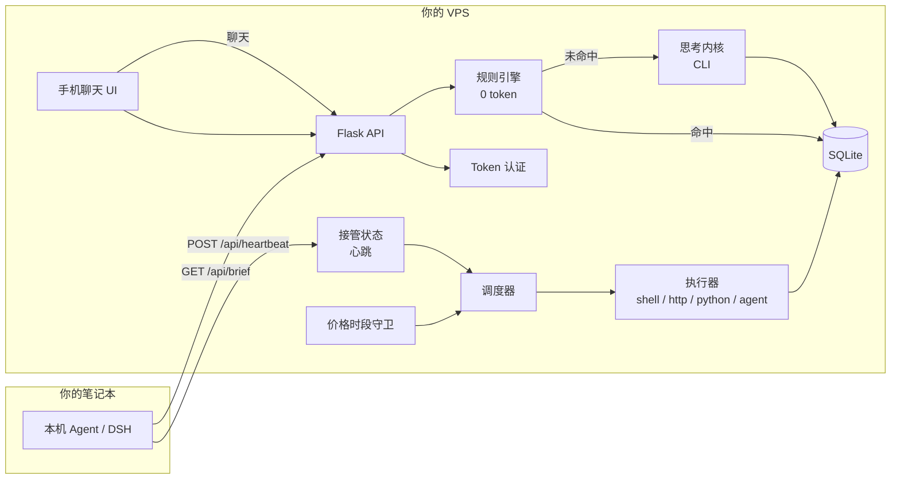

# Vigiliae · 更柝

**一个跑在你自己 VPS 上的 7×24 云端智能体团队：本机在线时本机接管，本机关机云端接手，重任务自动排到 API 半价时段。**

[](LICENSE)
[](#诚实状态)

## 名字的来历

### Vigiliae · 罗马的夜班

在罗马帝国，夜晚不是一整片黑暗。它被**等分为四个班次** —— *vigiliae*。
每一班约三小时，由不同的队伍值守，交班时前一班要把整座城**正式移交**给
后一班。夜里没有任何一个时辰是无人看守的。

这不是一个松散的习俗，而是一套制度。公元前 6 年左右，**奥古斯都**把
*vigiles*（守夜者们）编成常设的七个大队，负责罗马十四个区的消防与夜间
治安。他们的职责、隶属关系、以及失职的法律责任，被写进了法典：
**《学说汇纂》第 1 卷第 15 章**《关于消防长官的职责》。两千年前，一位
罗马法学家可以准确告诉你：第三班到第四班之间，这座城归谁负责。

这个词活到了今天：英语的 *vigil*（守夜）、*vigilance*（警觉）、
*vigilante*（义警）、西班牙语 *vigilia*、意大利语 *veglia* ——
它们都在说同一件事：**有人替你醒着，你才能睡。**

### 更柝 · 中国的五更

古典中国用同一套架构，解决了同一个问题，而且从未见过罗马。

古人把夜晚分为**五更**，从黄昏到黎明。每到一个更次，更夫走街，敲一种
叫**柝**的木梆。声音就是信号：*这一班还在守着，时辰已换，一切平安。*
这套制度给了汉语最常用的一句成语 —— **三更半夜**。

这个意象古老到出现在**《易经·系辞下》**里，讲的是君主如何守城：

> **重门击柝，以待暴客**
> *两道城门，敲着木梆，防备夜里的盗贼。*

它又出现在**《木兰辞》**里，描写戍卒的边塞之夜：

> **朔气传金柝，寒光照铁衣**

行政机制则见于**《周礼·夏官》**：一个叫「挈壶氏」的官职掌管漏刻计时、
命人击柝报更。到**《唐六典》**，官员值夜班有了正式术语：**上直**
（接班）、**下直**（下班）。交接是制度，不是客套。

### 两个文明，同一个发明

两套传统没有互相借鉴。罗马与汉朝相隔万里，并无往来。但它们各自抵达了
**完全相同的解法**：

> **把夜晚分段，一段交给下一段，所以总有人是醒着的。**

这正是本项目的全部机制。本机 Agent 与云端 Agent 轮流守夜。合上电脑，
云端接手；打开电脑，云端交还。两者之间，工作从不中断。

我们没有用机器人的名字命名它。我们用「守夜」命名它。

### 这和我们要做的东西有什么关系

*vigiles* 不只是「熬夜的人」。他们是一套**系统** —— 有编制、有排班、
有交接程序、有辖区、有装备标准、有法律问责。它的价值从来不是「有一个人
醒着」，而是**这套制度保证连续性，无论当晚具体是谁值班**。

这恰好就是我们面对的设计难题。一个 AI Agent 最难的不是让它跑一次，
而是让它**在你回家之后、明天凌晨三点，用同样的边界、同样的审计记录、
同样的标准继续跑** —— 然后在你回来时干净地把控制权交还给你。

Vigiliae 就是把那套制度写成了软件。这个名字提醒我们真正在造什么：
不是一个聊天机器人，不是一个模型，而是一支**不会断档的守夜队**。

---

> **诚实状态**：早期项目。Trustbase Lab 自 2026 年 10 月起在一台 4 核 / 7.5G 的
> 香港 VPS 上自用。单人维护，不是成熟的多租户平台，暂无完整测试套件。
> 如果你要的是打磨好的 Agent OS，请先看[对比文档](docs/COMPARISON.md)。

```
 本机 Agent（笔记本） ──心跳──▶  Vigiliae（VPS） ──▶  定时 Agent
        ▲                              │
        └────────── 聊天 / 任务总线 ◀───┘
```

---

## 为什么做这个

云端 Agent 的价值就在"你合上电脑它还在干活"。但大多数产品托管在厂商云里、
按席位收费，而且没法和你本机的 Agent 共享状态。

Vigiliae 是我们想要但没找到的那块小拼图：

- **持久任务执行器**：合上电脑照样跑；
- **接管协议**：本机和云端知道现在谁说了算；
- **价格感知调度**：不着急的重任务挪到便宜时段；
- **边界写在配置里**：由运行时执行，不靠 prompt 自觉；
- **手机可用的聊天 UI**：普通浏览器就能开，微信内置浏览器也能用。

它刻意**不是**一个 Agent 框架：不做自主规划、不内置浏览器。它只负责调度、
执行、守边界，把"思考"交给你已经信任的 CLI。

---

## 五个差异点

### 1. 本机 ↔ 云端无缝接管

本机 Agent 每 30 秒 `POST /api/heartbeat`。超过 `VIGILIAE_HEARTBEAT_TIMEOUT`
（默认 120 秒）没心跳，Vigiliae 判定本机离线，接管 `exec_pref=cloud|either`
的任务；本机回来后再交还 `local|either` 的任务。

```
本机在线  → role=local_primary   → 云端待命
本机离线  → role=cloud_takeover  → 云端执行
```

实现只有一张表和一条时间戳，没有共识协议、没有消息队列。

### 2. 价格时段感知调度

一些 LLM 厂商在工作日高峰收标准价、其余时段约五折。标了 `heavy: true` 的任务
如果在高峰触发，会自动推迟到下一个半价时段，并记录在 `data/deferred.json`，
可通过 `/api/deferred` 审计。

```
高峰：工作日 09:00–12:00、14:00–18:00（本地时间）
空闲：午间、晚上、夜间、周末、节假日
```

### 3. Agent 边界写死在 YAML 里

每个 Agent 有 `allow` / `deny` 列表。运行时在 prompt 之外还有三道闸门：

| 闸门 | 作用 |
|---|---|
| `write_perm=0` | shell 任务默认只读，危险命令模式直接拦截 |
| `need_approve=1` | 执行前挂起，进 `approvals` 等人工批准 |
| `deny` 列表 | 注入 prompt 作为硬约束 |

**安全边界是任务行，不是 prompt。**

### 4. 规则引擎 + LLM 双层

`status`、`tasks`、`runs`、`price`、`agents`、`inspect`、`help` 由关键词规则
引擎秒回，**0 token**。只有规则没命中的消息才交给思考内核。大多数聊天流量
因此是免费的。

### 5. 复用你已有的思考内核

Vigiliae 不内置模型运行时，只 shell 调用一个 CLI：

```bash
dsh --profile headless "<prompt>"
```

[DSH](https://github.com/deepseek-ai) 是参考实现；任何"输入 prompt、输出
答案"的 CLI 都可以（本地 Ollama 包装脚本、OpenAI 兼容脚本等）。接口形状不同
就改 `vigiliae/bridge.py`。

---

## 和 Grok Bots 对比

Star 数为 **2026-10-27** 通过 GitHub API 实测。"未记载"指当天读公开仓库
描述/README 没找到该能力，不等于不可能。完整矩阵见
[`docs/COMPARISON.md`](docs/COMPARISON.md)。

| 项目 | Stars | License | 自托管 | 本机↔云端接管 | 空闲时段调度 | 配置化边界 | 思考内核 |
|---|---:|:---:|:---:|:---:|:---:|:---:|---|
| **Vigiliae**（本项目） | — | MIT | ✅ | ✅ | ✅ | ✅ | 任意 CLI（默认 DSH） |
| Grok Bots（xAI） | 闭源 | 商业 | ❌（厂商云） | ❌ | ❌ | ❌ | 内置 |
| [rome](https://github.com/rome-os/rome) | 875 | MIT | ✅ | 未记载 | 未记载 | 未记载 | 内置 |
| [guilds](https://github.com/CigaleAI/guilds) | 65 | AGPL-3.0 | ✅ | 未记载 | 未记载 | 未记载 | 内置 |
| [agenhood](https://github.com/appssemble/agenhood) | 8 | MIT | ✅ | 未记载 | 未记载 | 未记载 | Claude Code / Codex / opencode |

Grok Bots 公开报道约 **$120–300/月/席位**（2026-10 公开信息，价格可能调整）。
Vigiliae 面向"我已经有一台 VPS"的场景：边际成本就是模型调用费，重任务还会
被推到便宜时段。

> 我们不声称功能对齐：rome / guilds 在 UI 和 Agent 侧更成熟。Vigiliae 的赌注
> 更窄——**小团队的所有权 + 接管 + 成本控制**。

---

## 架构



模块职责见 [`docs/ARCHITECTURE.md`](docs/ARCHITECTURE.md)。

---

## 三条命令跑起来

```bash
cp .env.example .env && cp agents.yaml.template agents.yaml   # 1. 配置（至少改 BOT_TOKEN）
docker compose up -d                                          # 2. 启动
# 打开 http://localhost:8110                                  # 3. 使用
```

注册示例团队：

```bash
docker compose exec vigiliae python -m vigiliae.agents sync
```

不用 Docker：

```bash
python -m venv .venv && . .venv/bin/activate
pip install -r requirements.txt
cp .env.example .env && cp agents.yaml.template agents.yaml
python -m vigiliae
```

> **没有思考内核也能用**：消息先存 SQLite，规则引擎即时回；本机 Agent 上线后
> 调 `GET /api/brief` 就能看到离线期间的所有消息。

---

## 写第一个 Agent

Agent = prompt + 排期 + 边界。参考
[`examples/my-first-agent.yaml`](examples/my-first-agent.yaml)：

```yaml
team:
  name: "One-agent team"
  orchestrator: "greeter"

agents:
  - name: "greeter"
    role: "Morning greeting"
    description: "Reads the task history and writes a one-paragraph morning note."
    schedule: "cron:0 8 * * *"
    timeout: 600
    heavy: false
    boundaries:
      allow: ["read task history", "write a message to the chat"]
      deny: ["modify tasks", "send external email"]
    prompt: |
      You are the morning greeter. Read the latest task runs and write one
      short paragraph: what happened, what failed, what to check first.
```

注册并手动跑一次：

```bash
python -m vigiliae.agents sync examples/my-first-agent.yaml
curl -X POST http://localhost:8110/api/tasks/agent_greeter/run
```

完整字段和 cron 语法见 [`docs/AGENTS.md`](docs/AGENTS.md)。

---

## API 一览

| 方法 | 路径 | 用途 |
|---|---|---|
| GET | `/api/health` | 存活检查（公开） |
| GET | `/api/status` | 角色、计数、价格时段、内核状态 |
| GET/POST | `/api/tasks` | 任务列表 / 新建 |
| POST | `/api/tasks/<id>/run` | 立即跑一次（可能返回 deferred） |
| POST | `/api/tasks/<id>/toggle` | 启停 |
| GET | `/api/runs` | 执行历史 |
| POST | `/api/heartbeat` | 本机心跳（公开） |
| GET | `/api/handover` | 当前谁接管 |
| GET | `/api/approvals` | 待审批 |
| POST | `/api/approvals/<id>` | `{"approve": true}` |
| GET/POST | `/api/messages` | 聊天队列 |
| GET | `/api/brief` | "我不在的时候发生了什么" |
| GET | `/api/whatsnew?since=...` | 某时间之后的变化 |
| GET | `/api/price_slot` | 当前高峰/空闲 |
| GET | `/api/deferred` | 被推迟的重任务 |
| GET | `/api/agents` | 已定义的 Agent |

---

## 配置

| 变量 | 默认 | 含义 |
|---|---|---|
| `BOT_TOKEN` | 空 | 访问令牌；空 = 开放调试模式 |
| `VIGILIAE_HOST` | `127.0.0.1` | 监听地址（Docker 用 `0.0.0.0`） |
| `VIGILIAE_PORT` | `8110` | HTTP 端口 |
| `VIGILIAE_DATA_DIR` | `./data` | SQLite / 日志 / 推迟记录 |
| `VIGILIAE_AGENTS` | `./agents.yaml` | Agent 定义文件 |
| `VIGILIAE_TZ_OFFSET` | `8` | 调度时区 |
| `VIGILIAE_HEARTBEAT_TIMEOUT` | `120` | 多少秒无心跳判定接管 |
| `DSH_BIN` | `dsh` | 思考内核可执行文件 |
| `DSH_TIMEOUT` | `180` | 单次调用超时（秒） |
| `DSH_DAILY_LIMIT` | `200` | 云端思考每日硬上限 |
| `VIGILIAE_HOLIDAYS` | 空 | 逗号分隔的 ISO 日期，按空闲处理 |

---

## 三种运行模式

**A. 完全不用 LLM**：任务执行器 + 规则引擎 + 留言队列，0 API 成本。
**B. 本机为主**：本机心跳并拉 `/api/brief`，云端只答简单指令、其余排队。
**C. 云端思考**：配置 `DSH_BIN` 和 key，未命中规则的消息异步交给内核。

---

## 诚实边界

- **单机**：SQLite、单进程，不能水平扩展。
- **不是沙箱**：`shell` 执行器只拦已知危险模式，真要隔离请用容器。
- **没有多租户**：一个团队、一个 token。
- **单人维护**：issue 可能回得慢。
- **暂无完整测试**：原部署靠 Agent 自己的回归任务验证，公开测试很少。
- **部分中文文案**：UI 和 prompt 中英混排，打磨不均。
- **Windows 未验证**：纯 Python 理论可跑，参考部署是 Linux。

---

## 路线图

- [ ] `price_slot` / `cron_match` 单元测试
- [ ] 第二个思考内核适配（Ollama）
- [ ] Webhook 执行器（GitHub / CI）
- [ ] Postgres 选项（多节点）
- [ ] 截图 + 60 秒 demo GIF
- [ ] CI 里的 `docker compose` 冒烟测试

---

## 贡献与许可

欢迎小而专注的 PR，见 [CONTRIBUTING.md](CONTRIBUTING.md) 和
[SECURITY.md](SECURITY.md)。MIT License，见 [LICENSE](LICENSE)。
