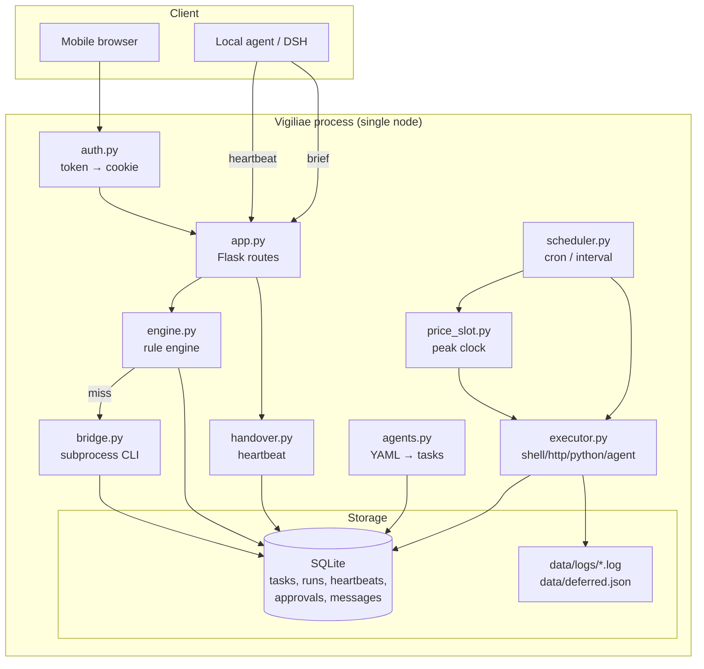
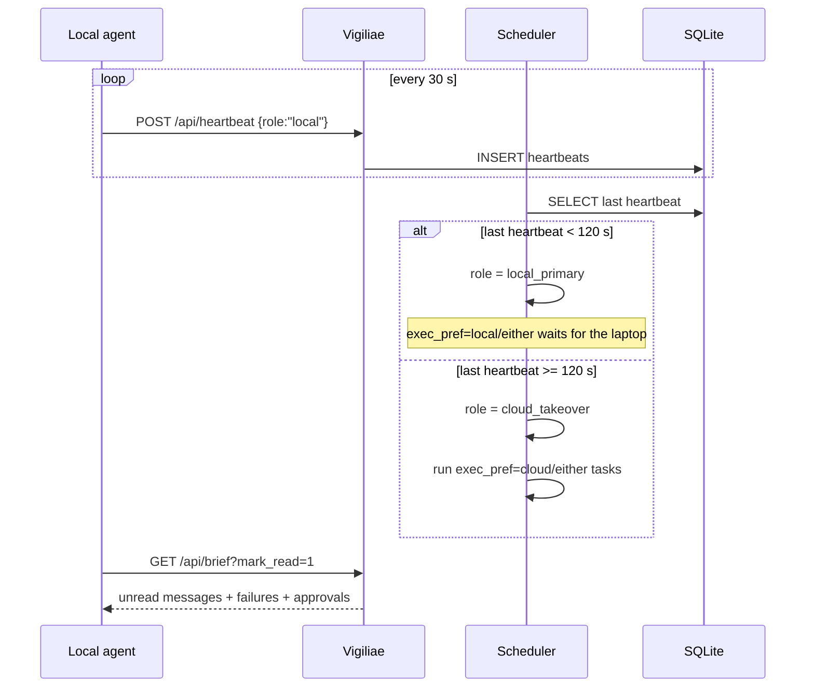
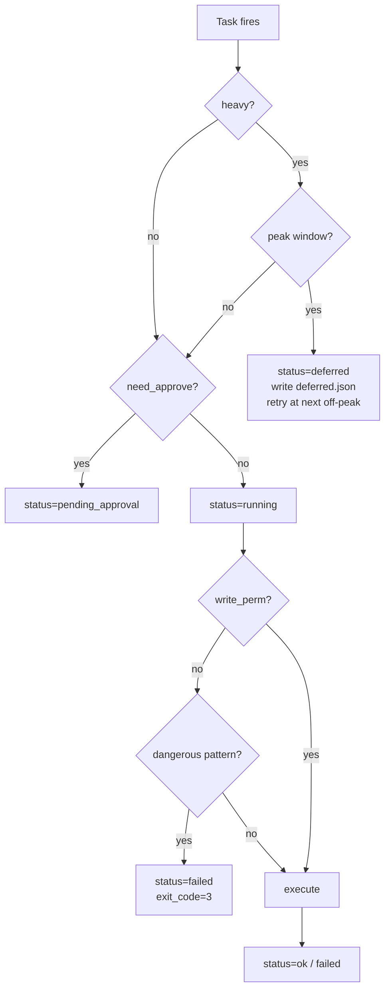
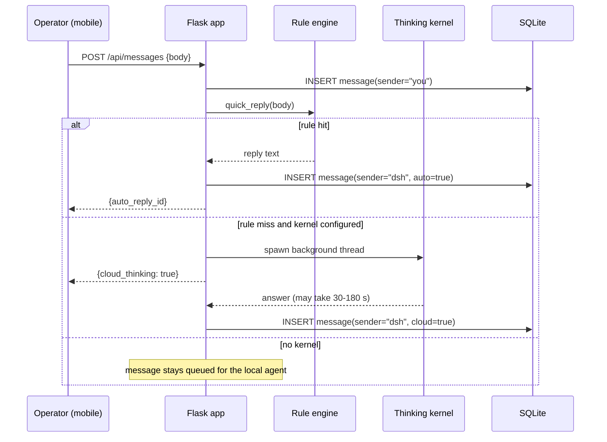

# Architecture

## Goals

1. Keep working when the laptop is closed.
2. Never lose a message or a task: SQLite is the source of truth.
3. Make the handover decision obvious and auditable (one heartbeat table).
4. Spend as little as possible: rule engine first, off-peak scheduling second.
5. Keep the codebase small enough that one person can audit it in an afternoon.

## Non-goals

- A general agent framework (no planner, no tool registry, no RAG).
- A sandbox. The shell executor is a convenience, not a security boundary.
- Multi-tenancy or horizontal scaling.
- A model runtime. Vigiliae delegates thinking to a CLI.

---

## Component diagram



---

## Data model

| Table | Key columns | Purpose |
|---|---|---|
| `tasks` | `id`, `kind`, `payload`, `schedule`, `heavy`, `write_perm`, `need_approve`, `exec_pref` | Declarative unit of work |
| `runs` | `run_id`, `task_id`, `status`, `exit_code`, `stdout`, `stderr`, `duration_ms` | Immutable execution log |
| `heartbeats` | `role`, `at`, `meta` | Liveness of the local agent |
| `approvals` | `task_id`, `status`, `requested_at`, `decided_at` | Human-in-the-loop gate |
| `messages` | `sender`, `body`, `reply_to`, `read_at`, `meta` | Chat queue between operator and agents |

`runs.status` ∈ `running | ok | failed | deferred | pending_approval`.

---

## Handoff protocol



`exec_pref` values:

| Value | Runs on local | Runs on cloud |
|---|:---:|:---:|
| `local` | ✅ | only if local is offline and the task is urgent? no — it waits |
| `cloud` | ❌ | ✅ |
| `either` | ✅ when online | ✅ when offline |

The current scheduler does not implement a queue for `local` tasks while the
local agent is offline; it simply skips them. This is intentional: "local" means
"needs the laptop's filesystem", so running it elsewhere would be wrong.

### Heartbeat flapping

A single missed heartbeat is tolerable: the threshold is 120 s while the
heartbeat interval is 30 s (four misses). If you run over a flaky mobile link,
raise `VIGILIAE_HEARTBEAT_TIMEOUT`.

---

## Scheduling and the price-slot guard



Peak windows are constants in `price_slot.py`:

```python
PEAK_WINDOWS = [(9 * 60, 12 * 60), (14 * 60, 18 * 60)]  # weekdays
```

Weekends and dates in `VIGILIAE_HOLIDAYS` are always off-peak. The scheduler
does not verify provider prices; it only implements the clock. If your provider
changes its windows, edit this list.

The deferral is recorded in two places: `runs` (a row with `status=deferred`)
and `data/deferred.json` (last 200 entries, exposed at `/api/deferred`).

---

## Message flow



The HTTP request never blocks behind the model. The UI polls
`/api/messages?since=<id>` every few seconds.

---

## Execution gates

Three independent gates, in order:

1. **Approval** — `need_approve=1` parks the run. Approve via
   `POST /api/approvals/<id> {"approve": true}`.
2. **Read-only** — `write_perm=0` blocks a list of dangerous shell patterns
   (`rm -rf /`, `mkfs`, `dd`, `curl | sh`, `DROP TABLE`, ...).
3. **Timeout / retries** — the executor enforces `timeout`; `retries` is stored
   for future use (the current scheduler does not retry automatically).

Pattern blocking is defense in depth, not a sandbox. See `SECURITY.md`.

---

## Design decisions and trade-offs

| Decision | Why | Cost |
|---|---|---|
| SQLite instead of Postgres | zero-ops, single file, easy backup | no concurrent writers at scale |
| Flask instead of FastAPI | smallest possible dependency | no async, no OpenAPI |
| subprocess bridge instead of SDK | works with any CLI, no vendor lock-in | prompt/answer only, no streaming |
| Token-in-URL instead of Basic Auth | works in WeChat / mobile browsers | token can leak in browser history; cookie mitigates |
| No task retries yet | keeps the state machine simple | a failed task waits for the next schedule |
| Agents are just tasks | no separate runtime to maintain | less expressive than a real agent framework |

---

## Failure modes

| Failure | Symptom | Mitigation |
|---|---|---|
| Local agent dies | `/api/handover` says `takeover: true` | cloud runs `cloud`/`either` tasks |
| Cloud process dies | no heartbeat writes, UI down | systemd `Restart=always` |
| Kernel hangs | message stays `cloud_thinking` | `DSH_TIMEOUT` + daily cap |
| SQLite locked | 500 on write | `timeout=30` on connect; single writer |
| Duplicate scheduled run | two runs in the same minute | `last_minute` guard per task |
| Token leaked | unauthorized access | rotate `BOT_TOKEN`, restart, cookies invalidated |

---

## Security model

- All routes except `/login`, `/logout`, `/api/heartbeat`, `/api/health`
  require the `cb_auth` cookie.
- The cookie value is the token itself, stored `HttpOnly; SameSite=Lax`.
  For production, put the app behind HTTPS so the cookie is not sent in clear.
- No secrets are stored in the database or logs. API keys are read from the
  process environment and passed only to the kernel subprocess.
- The `shell` executor runs with the privileges of the Vigiliae process. Run it
  as an unprivileged user and prefer `http`/`agent` tasks where possible.
